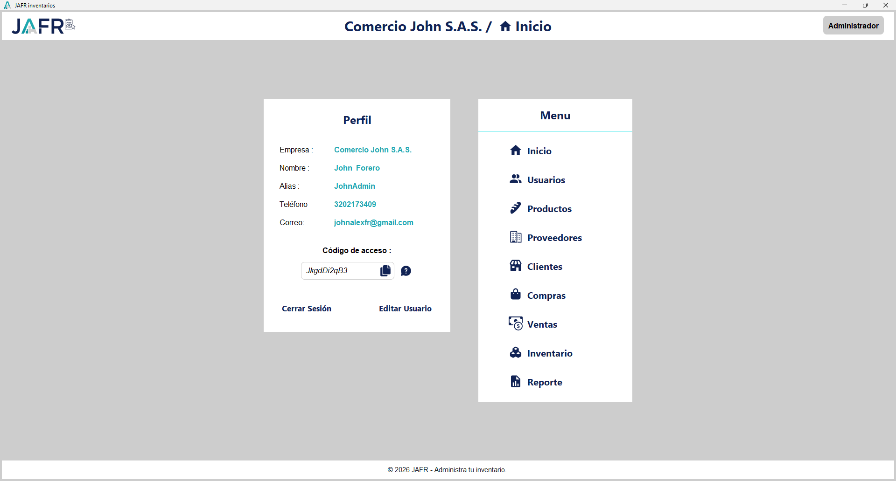
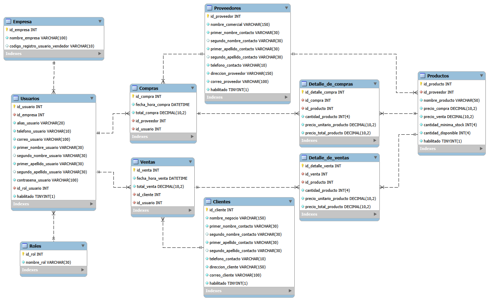

# JAFR Inventarios 📦


Aplicación de escritorio para la administración de inventarios de uso estrictamente interno. El sistema está diseñado para dos tipos de usuarios empleados (Administradores y Vendedores), permitiéndoles gestionar un catálogo de productos, controlar entradas (compras) y salidas (ventas) para afectar el stock en tiempo real, y administrar un directorio de clientes y proveedores de la empresa (sin integración con sistemas de terceros, pedidos externos o facturación). Construido bajo el patrón MVC, separando la interfaz de las consultas a la base de datos.

<p align="center">
  
</p>

## 📌 Características Principales

- **Arquitectura MVC:** Uso de `Modelos` para la creación y edición de registros en memoria. Los objetos inmutables `DTOs` (Data Transfer Objects) se utilizan para estructurar la información de credenciales después del inicio de sesión, el perfil del usuario, los reportes y para optimizar las consultas que pueblan las tablas visuales.
- **Integridad de Datos:** Las operaciones compuestas (como registrar una compra/venta y afectar el stock simultáneamente) operan bajo transacciones SQL manuales, utilizando (`setAutoCommit(false)`) si un detalle falla, se aplica un `rollback` automático garantizando que no queden registros a medias en la base de datos.
- **Gestor de Formularios:** Un motor propio (`GestorFormulario.java`) encargado de las validaciones de formato en la interfaz (expresiones regulares, campos vacíos). Aunque centraliza la recolección de datos y el mapeo de errores, trabaja en conjunto con la capa de servicios, donde se ejecutan las validaciones de negocio definitivas (como verificación de stock o unicidad de datos).
- **Reportes Dinámicos en Excel:** Exportación nativa a `.xls` utilizando Apache POI. Permite generar reportes con filtros dinámicos (Cantidades a Comprar, Histórico de Ventas y Compras) con un formato automatizado y listo para impresión o guardado en PDF.
- **Seguridad de Credenciales:** Hasheo de contraseñas con **jBCrypt** (OpenBSD bcrypt) y sistema integrado de recuperación mediante servidor SMTP (Jakarta Mail).

## 🚀 Demos y Prototipado

* 🎨 <a href="https://www.figma.com/proto/pYN1H69conYot0Ek1fP7XL/JAFR-administra-tu-negocio?node-id=51-335&p=f&t=aWtnb2YRYuq1RIxy-1&scaling=min-zoom&content-scaling=fixed&page-id=41%3A272&starting-point-node-id=51%3A335" target="_blank">Prototipo Interactivo (Figma)</a>
* 📐 <a href="https://www.figma.com/design/pYN1H69conYot0Ek1fP7XL/JAFR-administra-tu-negocio?node-id=41-272&t=x6iQhfH4hxAU1MDu-1" target="_blank">Diseño UI/UX (Figma)</a>
* 🎥 <a href="https://www.youtube.com/watch?v=MFGDYJwbK7Y" target="_blank">Video: Recorrido y Capacitación del Sistema</a>
* 🎥 <a href="https://www.youtube.com/watch?v=p8pGkJ9U9Zk" target="_blank">Video: Motor de Validaciones de Formularios</a>

## 🛠️ Tecnologías y Librerías Incluidas

El proyecto incluye físicamente todos los archivos `.jar` necesarios dentro del directorio `lib/`, por lo que no es necesario instalar gestores de dependencias externos:
* **Core:** Java SE 11 (Swing)
* **Base de Datos:** MySQL 8.0 (`mysql-connector-java-8.0.22.jar`)
* **Diseño UI:** FlatLaf 3.7.2 + FlatLaf Extras
* **Componentes:** `swing-datetime-picker-2.1.4.jar` (apoyado en MigLayout y JSVG)
* **Manejo de Archivos:** Apache POI 4.0.1
* **Testing:** JUnit 4.12 con Hamcrest
* **Mailing:** Jakarta Mail 1.6.7 + Jakarta Activation

💡 *Para más información detallada sobre el uso de cada librería, consulta el archivo [lib/README.md](lib/README.md).*

## ⚙️ Instalación y Configuración Local

### 1. Parámetros de Conexión
La aplicación se conecta por defecto al puerto `3306`. Verifica y ajusta las constantes en el archivo `jafrinventarios.servicios.ConexionDB.java` para que coincidan con tu usuario y contraseña de MySQL local:

```java
private static final String DB_NAME = "db_app_jafr";
private static final String USERNAME = "root";
private static final String PASSWORD = "12345678";
```

### 2. Despliegue de Base de Datos
En el directorio `database/` encontrarás los scripts SQL. Tienes dos opciones para levantar el entorno:

**Opción A: Modo Demostración (Recomendado)**
1. Importa el archivo **`db_app_jafr.sql`**. La base de datos se creará con un histórico de usuarios, compras, ventas, productos, clientes y proveedores listo para probar el sistema.
3. Inicia sesión con las siguientes credenciales:
   * **Administrador:** `johnalexfr@gmail.com` | Clave: `Forero12*`
   * **Vendedor:** `johnalexfr@hotmail.com` | Clave: `Forero12*`

**Opción B: Instalación desde Cero (Poblado Modular)**
1. Crea una base de datos vacía en tu gestor llamada `db_app_jafr`.
2. Ejecuta el script **`01_estructura_inicial.sql`** dentro de esa base de datos para crear las tablas y los roles.
3. Inicia la aplicación en tu IDE, da clic en **Regístrate** > **Administrador**.
4. Completa el formulario de registro. En el campo **Código de acceso**, ingresa el código configurado por defecto para autorizar al primer administrador: `JaFr_1pp4*`
5. *(Opcional)* Una vez tengas tu sesión iniciada como administrador, puedes ejecutar el script **`02_poblado_opcional.sql`** para cargar datos de prueba asociados a la empresa que acabas de registrar.

## 📂 Documentación

En la carpeta `/docs` encontrarás una selección de los entregables y diagramas principales del proyecto:

* **`/docs/arquitectura/`**: Diagrama Entidad-Relación (DER), Modelo Relacional (MER), Diagramas de Componentes, Despliegue y Actividades.
* **`/docs/manuales/`**: Manual Técnico (Prerrequisitos y estructura) y Manual de Usuario ilustrado.
* **`/docs/testing/`**: Reporte de casos de prueba integrados ejecutados con JUnit 4.

<p align="center">
  
</p>

## 👨‍💻 Autor
**John Alexander Forero Rubio**  
*Desarrollador de Software | Análisis y Desarrollo de Software (SENA)*